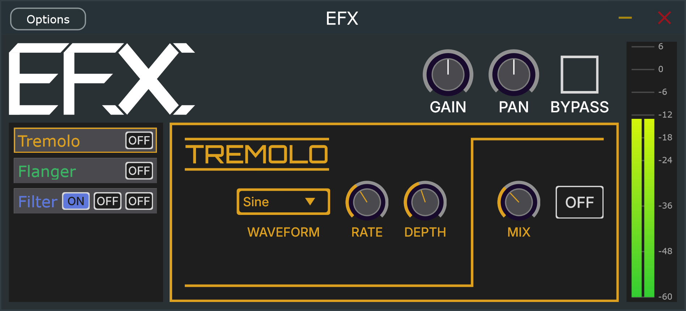

## EFX - Audio Effects plugin

EFX is an audio effects plugin written in C++ using the JUCE framework. When loaded inside of a DAW, it allows the use of the following audio effects:

- gain,
- pan,
- tremolo,
- flanger,
- 3 filters - lowpass, bandpass and highpass.

These effects are split into basic effects (gain and pan) and advanced effects. The advanced effects have multiple modifiable parameters and each of them use a distinct GUI. Additionally, the plugin offers a custom VU meter to measure the audio output.

The plugin was primarily tested in the VST3 format on both Windows and Linux systems.